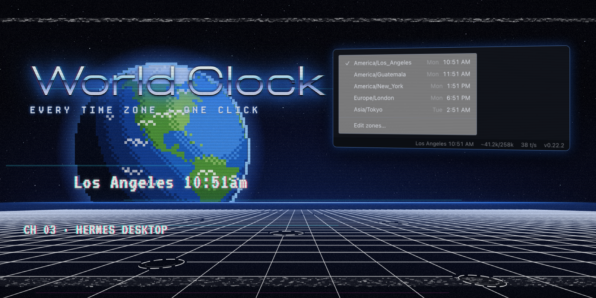
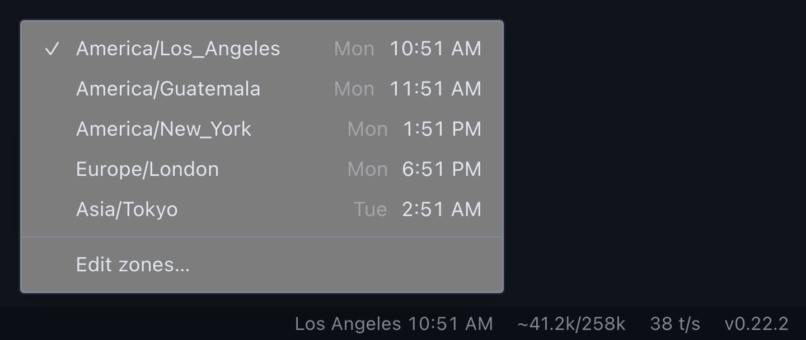

# World Clock for Hermes Desktop

Know what time it is wherever your people are, without leaving Hermes. World Clock puts one time zone in your status bar and keeps the rest a click away.



## What it does

- **Shows one zone in the status bar.** `Los Angeles 10:51 AM`, right next to your context meter. Hover for the day and UTC offset.
- **Switches with one click.** Click the time and a menu opens upward, listing every zone you've enabled with its local day and time. Pick one and the status bar follows it.
- **Lets you choose your zones.** **Edit zones…** at the bottom of the same menu lists 43 standard IANA zones with their current UTC offsets. Check the ones you work with. Your own zone is always on the list, even if it isn't one of the 43.
- **Stays out of the way.** Right-click the status bar and untick **World clock** to hide it. Tick it again to bring it back.

The menu holds exactly two things: your zones and the button to edit them. There are no other settings.



## Install

From the plugin catalog (once listed):

```bash
hermes plugins install world-clock
```

Or straight from this repository:

```bash
hermes plugins install https://github.com/cygnostik/hermes-world-clock
```

Then open **Capabilities → Plugins** in Hermes Desktop and turn on the **Desktop** switch for World Clock. Desktop halves of plugin packages ship switched off until you enable them.

## First run

The clock appears on the right side of the status bar showing your local zone, with UTC enabled as a second choice. Click it, choose **Edit zones…**, and tick the places you need. Your choices are saved and survive restarts.

## Details

- **Data and network:** none. Times come from your system's built-in time-zone database through the browser `Intl` API. The plugin makes no network requests and runs no backend.
- **Storage:** your enabled zones and current choice, in the plugin's own Hermes storage.
- **Footprint:** one timer per minute, aligned to the minute boundary, so the clock ticks over on time without polling.
- **Agent side:** none. No tools, hooks, middleware or environment variables.
- **Time format:** follows your system locale (12-hour or 24-hour).
- **Platforms:** anywhere Hermes Desktop runs. Tested on macOS.

## Uninstall

```bash
hermes plugins remove world-clock
```

## Development

```bash
npm test                         # zone list, offsets, storage migration, registration
node scripts/compose-media.mjs   # re-render docs/media from media/promo.html
```

Promotional art is rendered from `media/promo.html`. The menu and status bar images are captures of the plugin's own code running with Hermes Desktop's real menu components and stylesheet. Font credits are in [NOTICE.md](NOTICE.md).

## License

[MIT](LICENSE). World Clock is an independent community plugin, not an official Nous Research release.
